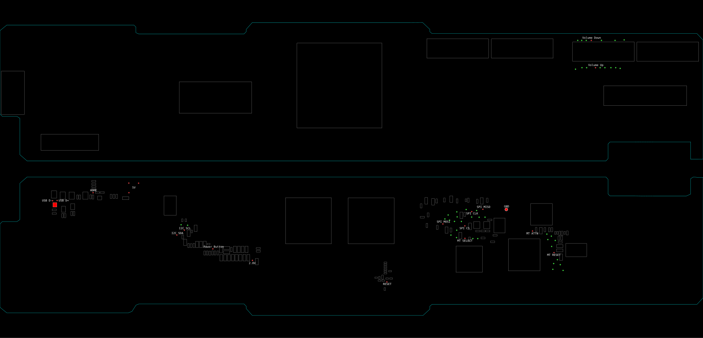
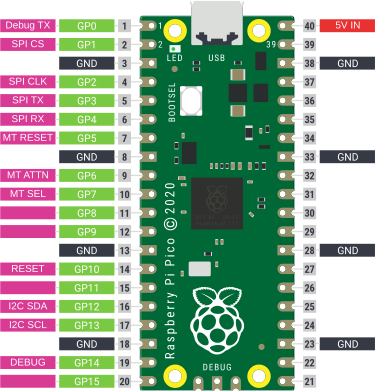

# Upcycling an iPad Into a Touch Screen

## [Watch the Video](https://www.youtube.com/watch?v=3t8xT-2vBE0)

For a long time, people have been taking the LCD panels out of 3rd and 4th generation iPads and making them regular ol' DisplayPort screens with the help of a driver board. These panels use eDP which is - as far as I'm aware - basically the same as regular DP. At least it's similar enough that these driver boards really only contribute backlight circuitry to the mix, passing the DP signal straight through to the panel. But what about the rest of the iPad? When I made a screen like this, I opted to keep it in the iPad frame with the glass protecting it. But then I thought it'd be cool if the glass still worked as a touch screen. That was the initial purpose of this work.

Older iPads like the 3rd generation have reached the end of their useful life a long time ago. iOS 9 has long been unsupported, most of these devices are iCloud Activation Locked anyway turning them into glossy paperweights. The other main goal of this project is to prevent these devices from becoming paperweights, or worse, contributing to the ever growing e-waste problem either by throwing it away or recycling it. The parts are still useful even if the whole is outdated.

This is the step-by-step guide for how to upcycle an iPad 3 into an almost\* universally compatible touch screen display.

\*macOS does not support HID Multitouch out of the box, so you might need to install additional software to make it work. Windows and Linux work totally fine with it in my tests, no drivers required. Thanks, standards!

> [!NOTE]
> Make these modifications and use this software at your own risk. I am not responsible for any damage you may cause to your iPad, Raspberry Pi Pico, or yourself. Soldering to the iPad logic board will void any warranty (not that there likely is one) and may permanently damage it if done incorrectly.

> [!NOTE]
> These instructions are specifically for an iPad 3rd generation, although it may also work with an iPad 4th generation. I haven't tried this at all, unfortunately, so you can see below for more thoughts on this but know that it's all _very speculative and unconfirmed_.

> [!TIP]
> The [YouTube video](https://www.youtube.com/watch?v=3t8xT-2vBE0) I published has an abridged but visual guide detailing this very process and might help you understand what to do when my words fail to convey the steps.

## How To Do It

To perform this, you should have the following parts and tools:

*   An iPad 3 (or possibly 4) that still turns on and boots. iCloud locked iPads are perfect for this since they boot into iOS. The ability to boot into iOS is only required for the training phase. After that, iOS will not be booted again. It is possible that you can train on a working iPad and then transplant the hardware into an iPad with, say, bad NAND and expect it to work, but this is currently unconfirmed. It's unknown if the calibration data the training phase records is different across iPads.
*   A Raspberry Pi Pico without pin headers. I use the Pico 1 with the RP2040, but I assume the RP2350 would also work. This guide assumes an original Raspberry Pi Pico.
*   An LCD Driver Board compatible with the iPad 3/4 eDP panel. Adafruit used to have one, but I prefer [the one from AbuseMark](https://abusemark.com/store/index.php?main_page=product_info&products_id=47:94b950f0d0042b7e09da67c3011ad6af). I've had great luck with the DisplayPort version of their board. I've had limited success with the HDMI version.
*   An NPN Transistor - I use a 2N2222.
*   Soldering iron, solder, and a “healthy” amount of flux.
*   Thin magnet wire - I use 30AWG which works well with the test pads we'll be soldering to, but 26AWG works in a pinch.
*   Some sort of thick double sided tape to affix the driver board to the LCD panel.
*   A Dremel or some other means of taking a chunk out of the iPad body.
*   Precision screwdrivers for disassembling the iPad.
*   A hot air gun (optional, but makes removing components and opening the iPad easier)
*   Kapton Tape or some other electrically isolating tape.
*   UV Cure Glue or Superglue for strain relieving solder joints.

### Step 1: Opening the iPad

First, you must completely disassemble the iPad. Use [the iFixit guides](https://www.ifixit.com/Device/iPad_3_Wi-Fi) to remove the following components from the iPad:

1.  Follow the instructions to [remove the logic board](https://www.ifixit.com/Guide/iPad+3+Wi-Fi+Logic+Board+Replacement/11603). Be careful not to slice through the digitizer and LCD cables. Set these and the logic board aside because we'll be using them later (obviously). Here are some tips:
    *   I used a hot air gun instead of an iFixit Opener. I tried the Opener, but it didn't impart enough heat. I used 200º heat at a medium airflow to loosen the adhesive enough to cut through it.
    *   The top of the iPad has the thickest and most annoying amount of adhesive. Gotta slice deep there, but not so deep that you touch the screen.
    *   Again, slice very shallow on the left side at the bottom, as that is where the digitizer cable is.
2.  Then, [remove the battery](https://www.ifixit.com/Guide/iPad+3+Wi-Fi+Battery+Replacement/11605). Most of the steps here are duplicated from above.
3.  Then, [remove the dock connector](https://www.ifixit.com/Guide/iPad+3+Wi-Fi+Dock+Connector+Replacement/11607). This will go back into the iPad so don't put it too far away.
4.  Then, [remove the speaker](https://www.ifixit.com/Guide/iPad+3+Wi-Fi+Speaker+Replacement/11614). More duplicated steps.

### Step 2: Cutting the Body

Now with all of the important bits out of the iPad, we can move on to modifying the case so that it can house the display driver board. Depending on the kind of board you have (HDMI, USB-C, DP, etc.) your cut may look slightly different, but the same rules apply.

The section of body you're removing will be at the lower right side of the iPad as you look at it face to face. Take the screen, rotate it 180º from how it came out, plug the driver board into the screen, and lay it down into the body. You will see where the driver board wants to sit. You need to remove the back such that the ports on the driver board stick out the back.

I used a Dremel tool with a cutting wheel. It took a long time, so I recommend a tool that is perhaps better suited for this sort of thing. However, once done, I put the metal brush end in the Dremel and smoothed out the edges so they weren't so sharp and jagged.

> [!WARNING]
> This process will produce aluminum shavings and dust. Beyond the obvious “wear protection” advice, you should also try to clean it up from the iPad body as much as possible as this dust can short the sensitive electronics later on and ruin the screen, logic board, or cause any number of untold hard to diagnose problems. A wipe down with a wet paper towel should get most of it.

### Step 3: Soldering to the Logic Board

First, we have to expose the bits we'll be soldering to. Remove the two biggest metal shields covering the bottom (non-A5X side) of the board. Also, remove the tape covering the test points opposite the 30-pin lego-style connector. With the exception of two optional pads for attaching Volume Up and Down, all of our points are going to be on this side of the board.

First, you need to remove an inductor (marked on the diagram with a red square). This inductor sits on the USB data lines between the 30-pin connector and the A5X (among other things). We want to physically disconnect the USB lines from the A5X, so removing this inductor is a good way to do that. This is best done with a hot air gun with a small nozzle. Once the inductor is gone, you can solder the D+ and D- lines. Then, proceed with soldering the rest of the required lines. The last wire to solder is from a 2.8V pad to the A5X-side of the inductor you just removed. This is to force the iPad into thinking it can fast charge and thus cold boot without a battery (it's supposed to be 2.7V but it's not picky).

Here comes the “fun” part: soldering all of the wires to the logic board. There are fifteen required wires and four optional wires.

1.  SPI MISO - data from the iPad to the Pico
2.  SPI MOSI - data from the Pico to the iPad
3.  SPI CLK - clock signal
4.  SPI CS - chip select
5.  MT\_SELECT - selects which SPI interface on the Z2 to use (one for boot, one for normal operation)
6.  MT\_RESET - multitouch reset line (hold low to reset)
7.  MT\_ATTN - multitouch attention line (goes low when data is available)
8.  I2C\_SDA - I2C data
9.  I2C\_SCL - I2C clock
10.  RESET - iPad reset line (use a transistor to pull this low)
11.  USB D+
12.  USB D-
13.  5V
14.  GND
15.  2.8V → solder to the A5X side (side furthest away from the close edge of the board) of the inductor you removed earlier, both pads

These next few are optional. I gave up on trying to connect buttons to the Pico because of weird iPad behaviors I was seeing (especially with the Power Button - it was causing it to boot loop and never allowed the Pico to train). It shouldn't be too difficult to implement volume up and down media keys in the HID descriptor, although that is left as an exercise to the reader. The volume button test pads are on the top side (A5X side) of the board so it'll get weird. But if you do end up soldering these, modify the firmware to make it do something cool!

*   Power Button
*   Volume Up Button (on top of board)
*   Volume Down Button (on top of board)
*   Home Button

<a href="https://raw.githubusercontent.com/lemonjesus/ipad-screen-private/refs/heads/main/img/ipad-3-solderpoints.svg"></a>

Click on the image to see a larger version.

I tried to make this diagram as clear as possible. The red square indicates the inductor you need to remove. The red circles indicate test pads you need to solder to. The labels indicate what each pad is for. I've included some chip outlines and unused testpads to help you orient yourself.

Strain relief the connections with UV cure glue or Superglue (after supergluing don't get it too hot as CA glue can produce fumes). These test pads are not very well attached to the iPad board, so don't give them a reason to rip off.

> [!TIP]
> It is strongly advised that you label these wires as you go so you don't confuse them later!

With the wires soldered, carefully reinstall the logic board back into the iPad body. If you did not opt to solder the optional buttons, you can skip reconnecting the forehead cable.

### Step 4: Soldering to the Pico

_You can do step 5 before this if you want to make sure the firmware makes it onto the Pico correctly before soldering all of the wires._

The first thing you should do is solder USB D+ and D- to the underside of the Pico. Use [this datasheet](https://pip-assets.raspberrypi.com/categories/610-raspberry-pi-pico/documents/RP-008307-DS-1-pico-datasheet.pdf?disposition=inline) to see where the pads are. 

The following diagram shows the default pins the firmware uses. If you deviate from this for some reason, be sure to change pins.h with the new definitions. Keep in mind that the SPI and I2C lines should be routed to GPIOs that support that mapping. Refer to a Pico Pinout diagram for more information.

I used a 2N2222 NPN transistor to handle the reset line. The base goes to the Pico GPIO you define in pins.h, the emitter goes to GND, and the collector goes to the iPad reset line. Likely any NPN transistor will work, but I haven't tested any others.

<a href="https://raw.githubusercontent.com/lemonjesus/ipad-screen-private/refs/heads/main/img/pico-pinout.svg"></a>

> [!WARNING]
> Make sure you update `pins.h` with the GPIO you're using for all of the features and connections!

### Step 5: Build and Upload the Firmware

A good way to test if the USB works correctly is to put the Pico into bootloader mode and upload the firmware through the 30-pin. If that works, then the HID data should also work just fine. Build with the following commands:

```sh
mkdir build
cd build
cmake ..
make
```

If you don't have the Pico SDK set up, CMake will attempt to download it for you.

> [!IMPORTANT]
> Make sure you have `gcc-arm-none-eabi`, CMake, and the other usual suspects installed!

> [!NOTE]
> It might take a while to build the first time as it compiles the SDK dependencies, but it should all Just Work™.

You can then copy the resulting `main.uf2` file to the Pico and it should boot and attempt to train from the iPad. Serial output is available on `GP0` if you're interested in its success/failure. If it fails, try again and again. I've seen some flakiness that I wasn't able to pin down. This is the critical step that might misbehave if the solder joints are bad or the iPad isn't firing up correctly. An oscilloscope or logic analyzer is likely needed to debug from this point on. But, assuming on your first or fifth try it trains, you should be good to go.

### Step 6: Putting It Back Together

Now it's time to put it all together! First, you have to cut/wiggle off the brackets from the screen so that it will fit 180 degrees rotated (being sure to keep the other brackets intact so it has _something_ to screw into). Semi-permanently affix the LCD controller board to the LCD panel with double sided thick tape. Carefully plug the digitizer back into the logic board and, while holding it at an angle from the iPad, place the LCD panel back into the iPad body (lining up the screen's brackets and the hole you cut for the driver board). Once that's screwed in, place the digitizer back in its rightful place. Plug everything in and ensure that it all works correctly. If it does, use some sort of adhesive - from double sided Scotch Tape to full blown proper screen adhesive - to glue the digitizer back into place. I personally had trouble making the glass sit flush in my test run, but I think it's because the glass I was using was from a different iPad body, and the corners on this one were a little bit damaged.

And that's it, you're done!

## How Does This Work?

The Raspberry Pi Pico exposes a USB HID Multitouch Device that communicates with the iPad's Multitouch Subsystem. The Pico uses SPI to communicate with the subsystem, holding the A5X in reset and running the system itself. It also uses I2C to configure the PMU (Power Management Unit) to ensure the Z2 subsystem is powered correctly.

The firmware has two main phases: training and normal operation. During the training phase, the firmware allows the iPad to completely boot. It watches the SPI bus for the bootloader sequence and records all of the messages sent to the multitouch subsystem. This is done to capture the calibration data (which may differ between iPads, unconfirmed) and the firmware that the iPad sends (so I don't have to include it here). The recording is finished when the iPad sends an execute packet, at which point the firmware saves all of the recorded data to flash memory on the Pico and resets the iPad.

From this point on, the firmware enters normal operation. The A5X will be held in reset forever since we don't need it. The firmware replays the recorded boot sequence to the multitouch subsystem, effectively booting it as if it were the A5X. Once the subsystem is booted, the firmware listens for touch events and translates them into USB HID Multitouch reports which are sent to the host computer.

## Will This Work With Other iPads?

### iPad 4th Generation
The firmware should Just Work™ with an iPad 4th generation. The problem is generally hardware related:
 - The solder points for the required connections are likely different, you'll need to find the correct ones for the iPad 4.
 - The iPad 4 introduces the Lightning connector, which may have different USB data line routing. This has not been tested.
 - The PMU might be different, so the I2C configuration may need to be adjusted.

As far as I know, though, the hardware for the digitizer remains mostly unchanged. You're welcome to try it for yourself. If you do, please open an issue or a pull request with your findings.

### iPad 1st and 2nd Generation
The firmware _might_ Just Work™ (with some modification) with an iPad 1st and 2nd generation with much of the same caveats as the iPad 4th generation. However, these iPads do not use eDP for their display, so you'll need to find a different LCD driver board compatible with the older iPads' panel. I think it's LVDS, but I'm not sure. This is very much speculative and untested, but the chips used for the multitouch subsystem appear to be the same.

### Other iPads
Other iPads (Air, Mini, Pro, etc.) use different multitouch subsystems and likely different PMUs. This firmware will not work with these iPads without significant modification.

## How Was This Developed? (and other acknowledgements)

This project was developed through a lot of trial and error, poking around various testpoints and deciphering signals with a logic analyzer. A lot of understanding about how the Z2 Multitouch Subsystem works comes from other projects. You can find snippets and references to these projects throughout my code. The biggest sources of knowledge were:

 - [openiBoot](https://github.com/iDroid-Project/openiBoot) has some code for initializing the Z2 Multitouch Subsystem and it was very helpful with understanding the initialization sequence.
 - [devos50's QEMU fork](https://github.com/devos50/qemu-ios) - capable of running very old versions of iOS - emulates multitouch and is where I learned what the message type constants were.
 - [Asahi Linux's Z2 Driver](https://git.kernel.org/pub/scm/linux/kernel/git/torvalds/linux.git/tree/drivers/input/touchscreen/apple_z2.c) which was recently upstreamed into the Linux kernel. Ostensibly for the Touch Bar on Macs, it also helped with understanding the non-boot protocol. I even went so far as to email the author of this driver when I was really stuck. Thank you, Sasha, for your time!

I also met a German guy who just so happened to be visiting my city, checking out local hackerspaces as he's wont to do I guess, and he inspired me to hunt down the reset line which was a big breakthrough in getting this to work. Thank you, Florian!

## License
The code is licensed under GPLv3, everything else is CC-BY-NC 4.0
